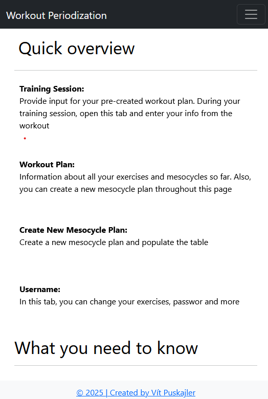
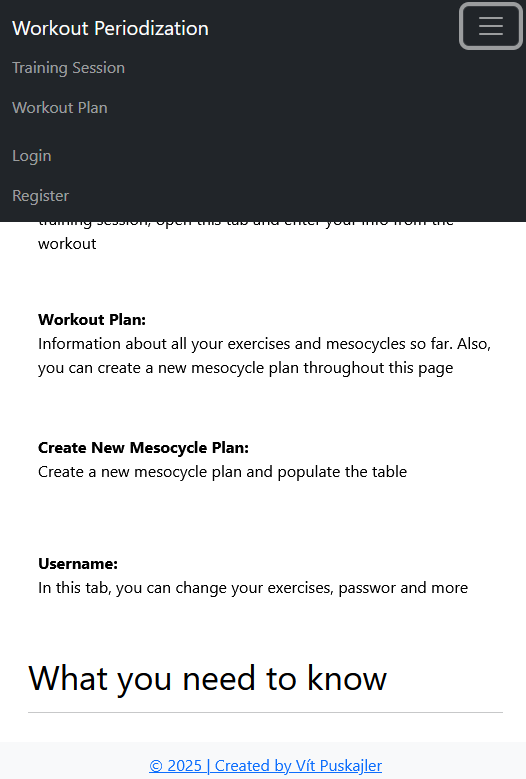
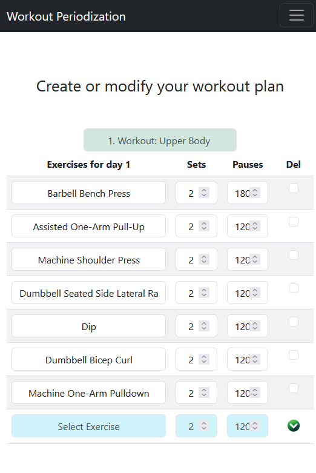
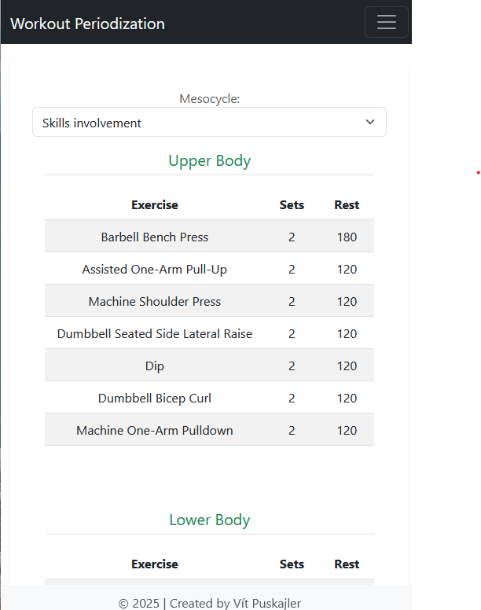
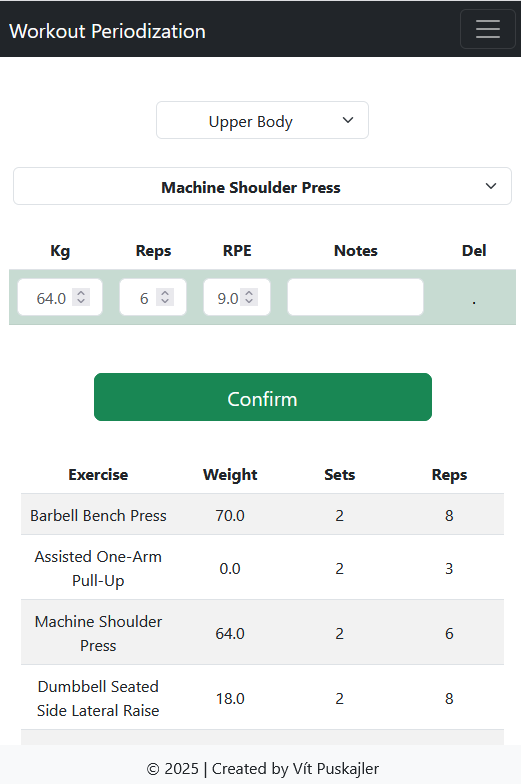
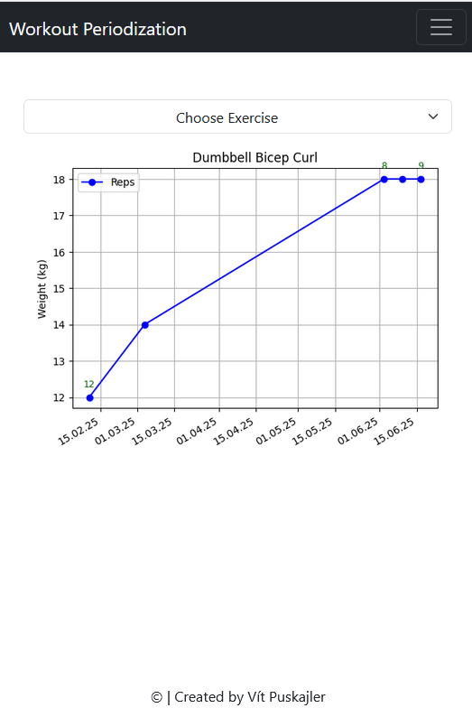

## Workout Periodization

Workout Periodization is a lightweight, customizable workout diary tailored for athletes and fitness enthusiasts. This personal web app is built to help you plan and track your training sessions with a strong focus on periodization, ensuring your workouts evolve with your progress.

### Key Features

- **Intuitive Workout Logging:** Effortlessly record your exercises and monitor progress with a user-friendly diary interface.
- **Customizable Periodization:** Structure your training with up to 4 working sets per session, making it ideal for focused, periodized routines.
- **Dynamic Exercise Modifications:** Easily update and modify exercise details to match your evolving workout plan.
- **Inclusive Registration:** Seamless, validated sign-up enables anyone to start quickly.
- **Lightweight & Responsive:** Designed for optimal performance with fast load times and smooth navigation.

### Training Stopwatch

A dark bar pinned to the bottom of Training Session and Freestyle Training times your rests between sets.

| Control | What it does |
|---|---|
| **Start** | Starts the stopwatch (optional - the first logged set starts it too). The clock shows the warm-up. |
| **Go** | Tap right before a set. The rest freezes and the set is timed. **Cancel** undoes it. |
| **Confirm / Repeat** | Logs the set and starts the rest clock. |
| **Tap the clock** | Swaps between the lap (warm-up / rest / set) and the total time in the gym. Logging a set or tapping Go swaps back. |
| **Power icon** (bottom left) | "Finish the workout?" - **Finish** stops the stopwatch, **Continue** keeps it running. |

Good to know:

- The rest clock is green until the planned pause (`rest_period`) of the exercise is over, then red. A lap is only coloured between two sets of the **same planned exercise**; switching exercise, and all of Freestyle Training, stay neutral.
- With no logged set for **30 minutes** the stopwatch switches itself off; the next set starts a fresh run.
- All numbers are computed from timestamps, so a locked phone or a page reload does not make the clock drift. The run's start and the Go tap live in the browser's localStorage and are sent with every set.
- Every set stores `exercise_entries.logged_at`, with or without the stopwatch. `started_at` (the Go tap) is filled only when Go was used, and the manual Start overwrites the session's start time.
- Both columns are naive UTC and empty on sets logged before the stopwatch existed. Existing databases need a one-off `python temp/add_stopwatch_columns.py` (locally and on PythonAnywhere).
- Rest between two sets = next `logged_at` minus this `logged_at` (it includes the next set's duration unless `started_at` is present). Gaps over ~15 minutes, or only seconds apart (sets typed in afterwards), should be ignored in statistics.

### Try It Out

Experience the app in action by visiting the [Live Demo](https://vito.pythonanywhere.com/).

Fork, customize, and use Workout Periodization as your personal training companion. Whether you're an experienced lifter or just beginning your fitness journey, this app provides the structured approach you need to achieve your goals.

## Preview

> **Note:** The app is still under development, with new features and improvements on the horizon.
